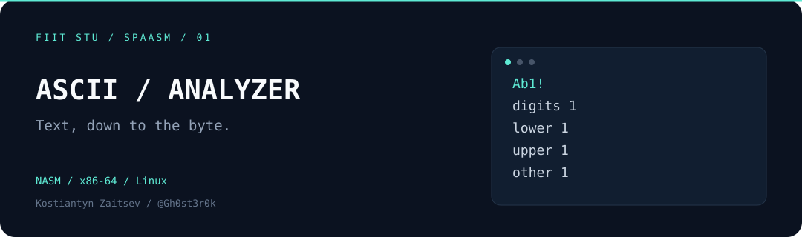

# ASCII Analyzer

An ASCII character counter written in **x86-64 assembly** for Linux. Reads text files, counts four character classes for each line, and prints totals across the input — using Linux system calls directly, without a C runtime.

**[Quick start](#quick-start) · [Example](#example) · [Inside the project](#inside-the-project) · [Companion project ↗](https://github.com/Gh0st3r0k/FIIt-STU-SPAASM-Zadanie2)**

## What it does

- Counts digits, lowercase letters, uppercase letters, and other characters.
- Reports per-line statistics and totals across input files.
- Supports reverse line order with `-r` and pagination with `-p`.
- Keeps input processing, counting, and number formatting in separate assembly modules.

## Quick start

Requires **Linux x86-64**, **NASM**, and **GNU ld** (Binutils). Run these commands from the repository root:

```sh
for unit in main lib data utils strlen analyze_line print_number; do
    nasm -f elf64 "$unit.asm" -o "$unit.o" || exit 1
done
ld main.o lib.o data.o analyze_line.o utils.o strlen.o print_number.o -o program

./program -h
```

## Example

```sh
printf 'Ab1!\nz9\n' > /tmp/ascii-sample.txt
./program /tmp/ascii-sample.txt
```

```text
Line number #1: Digits = 1, small letters = 1, capital letters = 1, other = 1
Line number #2: Digits = 1, small letters = 1, capital letters = 0, other = 0

Total across all lines: Digits = 2, small letters = 2, capital letters = 1, other = 1
```

### Options

| Option | Behavior |
| :--- | :--- |
| `-h` | Print usage information |
| `-r` | Print line statistics in reverse order |
| `-p` | Pause after every 10 lines of output |

```sh
./program /tmp/ascii-sample.txt -r
./program first.txt second.txt -p
```

## Inside the project


| File | Responsibility |
| :--- | :--- |
| [`main.asm`](main.asm) | Process entry point and top-level flow |
| [`lib.asm`](lib.asm) | Argument parsing, file processing, and result output |
| [`analyze_line.asm`](analyze_line.asm) | Character classification and per-line counters |
| [`print_number.asm`](print_number.asm) | Integer-to-text conversion and output |
| [`utils.asm`](utils.asm), [`strlen.asm`](strlen.asm) | Output helpers and string length |
| [`data.asm`](data.asm), [`macros.inc`](macros.inc) | Messages, constants, and formatting macros |

The implementation brings together register-level string processing, ELF64 object files, manual integer formatting, and the Linux syscall interface.

## Scope and limits

This is an educational ASCII text processor. Input uses LF (`\n`) line endings; Unicode character classification is outside its scope. The original assignment documents limits of 4,096 lines across input files and 4,095 characters per line. Use small ASCII files for demonstrations; these limits are not a guarantee of robust handling of oversized or malformed input.

## About

**Kostiantyn Zaitsev · [@Gh0st3r0k](https://github.com/Gh0st3r0k)**

FIIT STU · SPAASM · Assignment 1 · Summer semester 2024/2025

AIS ID: 123101

Part of a pair of systems programming assignments. Continue with **[Socket Shell](https://github.com/Gh0st3r0k/FIIt-STU-SPAASM-Zadanie2)** to explore processes and TCP communication in C.
